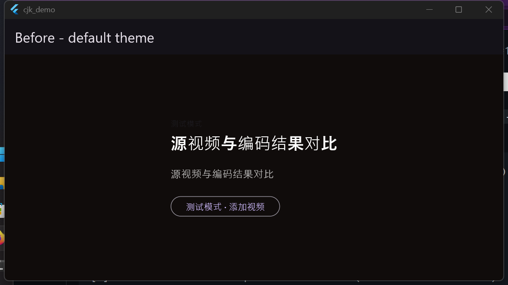

# flutter_zh_char_fix

[](https://pub.dev/packages/flutter_zh_char_fix)

Fixes the mixed Chinese/Japanese font fallback that makes some Chinese
characters render with wrong glyph shapes or weights on Flutter Windows.

## The problem

On Windows, Flutter's text engine (SkParagraph) resolves CJK glyphs **one
character at a time** when the theme's primary font (Segoe UI) does not cover
them. Because Chinese system fonts have no `w500` face while Japanese fonts do,
Skia may pick a Japanese font for characters shared with Japanese and different
Chinese fonts for Chinese-only characters. The result is a single line containing
glyphs from three or four different typefaces — different stroke shapes,
different weights, and Japanese glyph variants in Chinese text.

This is tracked upstream in
[flutter/flutter#103811](https://github.com/flutter/flutter/issues/103811)
(font selection) and
[flutter/flutter#105014](https://github.com/flutter/flutter/issues/105014)
(weight matching). Declaring `supportedLocales` helps in some cases, but a
generic `zh` locale (which is what `Locale('zh')` resolves to) still leaves the
fallback ambiguous.

**Before** — `源视频与编码结果对比` mixes glyphs from several families (in our
test: Yu Gothic, DengXian, Noto Sans SC and Microsoft YaHei):



**After** — every CJK glyph comes from Microsoft YaHei UI:


Zoomed comparison:


## How it works

The package returns a `fontFamilyFallback` chain that pins Chinese font
families. When the theme's primary font lacks a CJK glyph, Skia now finds every
Chinese character inside the same family instead of querying the system per
character.

The app locale is read from the widget context with the
[is_zh](https://pub.dev/packages/is_zh) package. The fix only applies on Windows
for Chinese locales; everywhere else nothing changes:

- `isZh(context)` — language is `zh`; required for any chain to be returned.
- `isZhTraditional(context)` — script `Hant`, or region `TW`/`HK`/`MO`:
  returns the Traditional Chinese chain.
- everything else Chinese (including a bare `zh` locale) — returns the
  Simplified Chinese chain.

## Usage

```yaml
dependencies:
  flutter_zh_char_fix:
    path: ../flutter_zh_char_fix
```

Wrap the app in `MaterialApp.builder`, where a `Localizations` context is
available:

```dart
import 'package:flutter_zh_char_fix/flutter_zh_char_fix.dart';

MaterialApp(
  builder: chineseFontFallbackBuilder(),
  // ...
);
```

`chineseFontFallbackBuilder` composes with an existing builder when you pass
one:

```dart
MaterialApp(
  builder: chineseFontFallbackBuilder(_other_builder_),
  // ...
);
```

It is a no-op when no fix applies. If you need to apply the chain yourself,
`chineseFontFallback(context)` returns it (or `null`), and the two chains are
exported as constants:

- `simplifiedChineseFontFallback` — Microsoft YaHei UI, YaHei, DengXian, SimHei
- `traditionalChineseFontFallback` — Microsoft JhengHei UI, JhengHei, MingLiU, PMingLiU

## Behaviour

`chineseFontFallback(context)` returns:

| Platform / app locale                                                 | Result                    |
| --------------------------------------------------------------------- | ------------------------- |
| Windows, Traditional Chinese (`zh-Hant`, `zh-TW`, `zh-HK`, `zh-MO`)   | Traditional Chinese chain |
| Windows, other Chinese locales (`zh`, `zh-Hans`, `zh-CN`, `zh-SG`, …) | Simplified Chinese chain  |
| Windows, non-Chinese (`en`, `ja`, `ko`, …)                            | `null`                    |
| macOS, Linux                                                          | `null`                    |

The context must be below a `Localizations` widget, otherwise `is_zh` asserts.
`MaterialApp.builder` is the recommended place.

## Notes

- Windows only. The package imports `dart:io`; it is not usable on web.
- Requires the Chinese fonts that ship with Windows language support
  (Microsoft YaHei / Microsoft JhengHei). The chains include fallbacks
  (DengXian, SimHei, MingLiU) in case a family is missing.
- A bare `zh` locale gets the Simplified chain. To receive the Traditional
  chain, the app's resolved locale must carry a Traditional script or region
  (for example by adding `zh_TW` to `supportedLocales`).
- Pinning a family gives **consistent** glyphs, but it also overrides the
  regional font choice for mixed-language content. If an application must render
  Simplified Chinese, Traditional Chinese, Japanese and Korean text with native
  regional glyphs, bundle a font with language-specific glyph variants (for
  example Noto Sans CJK) and pass the correct `Text.locale`; this package is the
  lightweight workaround for Chinese UI text.
- The fallback is applied through `Theme`, so text that does not inherit the
  app theme is not affected.
