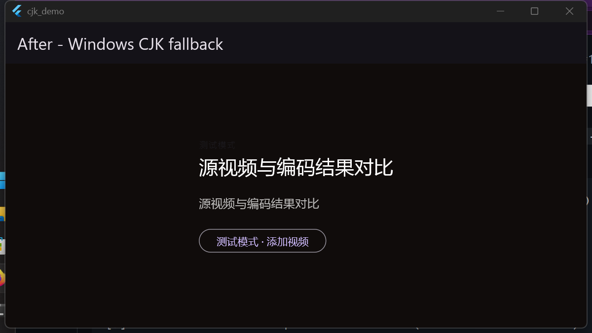
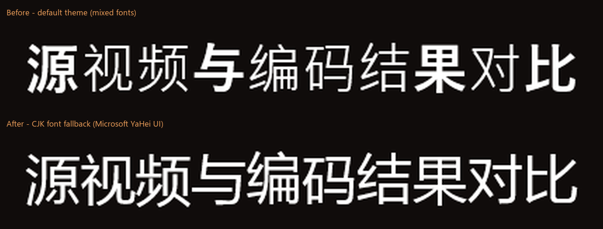

# flutter_zh_char_fix

[](https://pub.dev/packages/flutter_zh_char_fix)

Fixes the mixed Chinese/Japanese font fallback that makes some Chinese
characters render with wrong glyph shapes or weights on Flutter Windows.

- Only applies to Windows.
- Only applies to Chinese locales (Both simplified and traditional Chinese).

## The problem

On Windows, Flutter's text engine (SkParagraph) resolves CJK glyphs **one
character at a time** when the theme's primary font (Segoe UI) does not cover
them. Because Chinese system fonts have no `w500` face while Japanese fonts do,
Skia may pick a Japanese font for characters shared with Japanese and different
Chinese fonts for Chinese-only characters. The result is a single line containing
glyphs from three or four different typefaces — different stroke shapes,
different weights, and Japanese glyph variants in Chinese text.

This is tracked upstream in
[flutter/flutter#103811](https://github.com/flutter/flutter/issues/103811)
(font selection) and
[flutter/flutter#105014](https://github.com/flutter/flutter/issues/105014)
(weight matching). Declaring `supportedLocales` helps in some cases, but a
generic `zh` locale (which is what `Locale('zh')` resolves to) still leaves the
fallback ambiguous.

**Before** — `源视频与编码结果对比` mixes glyphs from several families (in our
test: Yu Gothic, DengXian, Noto Sans SC and Microsoft YaHei):


**After** — every CJK glyph comes from Microsoft YaHei UI:



Zoomed comparison:



## Usage

Pass `chineseFontFallbackBuilder()` to `MaterialApp.builder`:

```dart
import 'package:flutter_zh_char_fix/flutter_zh_char_fix.dart';

MaterialApp(
  builder: chineseFontFallbackBuilder(),
  // ...
);
```

If you have an existing builder, you can compose it with `chineseFontFallbackBuilder()`:

```dart
MaterialApp(
  builder: chineseFontFallbackBuilder(_other_builder_),
  // ...
);
```
